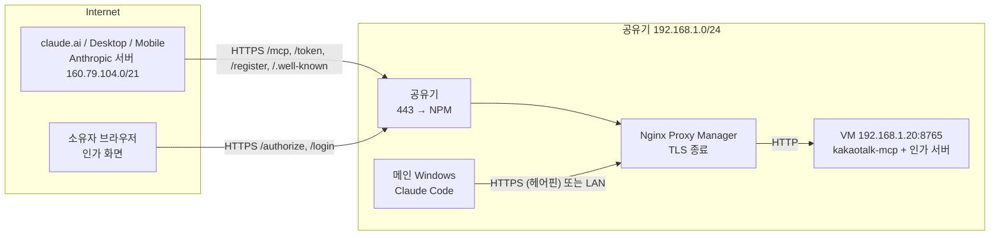
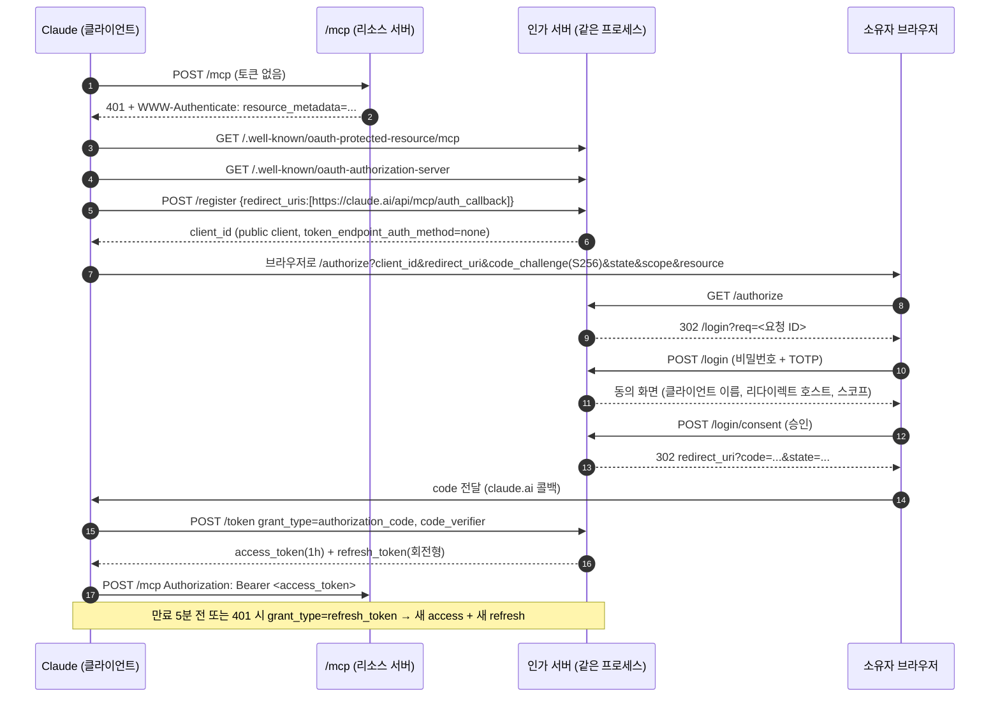

# 원격 접속 설계: Nginx Proxy Manager + OAuth 2.1

Claude(claude.ai 웹/데스크톱/모바일, Claude Code)에서 **커스텀 커넥터**로 이 MCP 서버를 연결하기 위한 설계입니다.
사용자는 한 명(소유자)뿐이고, 서버는 카카오톡 계정을 조작할 수 있으므로 "인터넷에 노출된 개인 원격 제어 도구"로 보고 설계합니다.

요구사항 출처: [Claude 커넥터 인증 문서](https://claude.com/docs/connectors/building/authentication), [MCP Authorization 명세](https://modelcontextprotocol.io/specification/2025-11-25/basic/authorization).

## 1. 목표와 위협 모델

| 목표 | 설계 결정 |
|---|---|
| claude.ai 커스텀 커넥터로 연결 | OAuth 2.1 인가 서버를 MCP 서버 안에 내장 (DCR + PKCE S256) |
| Claude Code / 스크립트에서도 사용 | 같은 OAuth(loopback 리다이렉트) + 개인 액세스 토큰(PAT) 헤더 |
| 소유자 외에는 아무도 쓰지 못함 | 인가 화면에서 **소유자 비밀번호 + TOTP** 로그인 후 동의 |
| 토큰이 새도 피해 최소화 | 짧은 액세스 토큰, 회전형 리프레시 토큰, 재사용 감지 시 전체 폐기, 스코프 분리 |

막아야 할 것:
- 공개 URL을 알아낸 제3자가 DCR로 클라이언트를 등록하고 인가를 시도하는 경우 → 등록은 허용하되 **인가는 소유자 로그인 없이는 불가능**하게 하고, 리다이렉트 URI를 허용 목록으로 제한
- 인가 화면 무차별 대입 → 로그인 속도 제한과 잠금, TOTP
- 탈취된 리프레시 토큰 재사용 → 회전 + 재사용 감지(토큰 패밀리 폐기)
- 프록시 뒤 Host/Proto 위조 → 공개 URL은 설정값으로 고정, 프록시 헤더는 NPM IP에서만 신뢰

## 2. 네트워크 구성



- **도메인**: 예) `kakao-mcp.example.com`. MCP URL(= OAuth `resource`)은 `https://kakao-mcp.example.com/mcp`로 고정합니다. 커넥터에 입력하는 URL과 **문자 하나까지 같아야** 합니다.
- **인가 서버(issuer)**: 같은 도메인의 루트 `https://kakao-mcp.example.com`. 한 도메인에서 `/.well-known/*`과 `/mcp`를 모두 서비스하므로 탐색 문제가 없습니다.
- **VM 방화벽**: `KakaoMCP-HTTP`(8765)의 허용 주소를 192.168.1.0/24에서 **NPM 호스트 IP 하나**로 좁힙니다.

### 2.1 NPM 설정

Proxy Host:
- Domain: `kakao-mcp.example.com`, Scheme `http`, Forward `192.168.1.20:8765`
- SSL: Let's Encrypt, Force SSL, HTTP/2, HSTS 켬
- Block Common Exploits 켬, Websockets 지원은 필요 없음

Advanced 탭 (Streamable HTTP는 SSE로 응답을 흘려보내므로 버퍼링을 끕니다):

```nginx
proxy_http_version 1.1;
proxy_set_header Connection "";
proxy_buffering off;
proxy_cache off;
proxy_read_timeout 3600s;
proxy_send_timeout 3600s;
client_max_body_size 4m;
```

선택: Anthropic 대역만 API에 접근하도록 제한 (브라우저가 쓰는 `/authorize`, `/login`은 열어둠):

```nginx
location ~ ^/(mcp|token|register|revoke|\.well-known/) {
    allow 160.79.104.0/21;   # Anthropic egress
    allow 192.168.1.0/24;    # LAN (Claude Code)
    deny all;
    proxy_pass http://192.168.1.20:8765;
    proxy_http_version 1.1;
    proxy_set_header Connection "";
    proxy_set_header Host $host;
    proxy_set_header X-Forwarded-For $proxy_add_x_forwarded_for;
    proxy_set_header X-Forwarded-Proto $scheme;
    proxy_buffering off;
    proxy_read_timeout 3600s;
}
```

밖(카페 등)에서 Claude Code를 쓰려면 이 제한을 쓰지 않거나 그때의 공인 IP를 추가해야 합니다. 기본은 제한 없이 시작하고 인증으로 막습니다.

## 3. 엔드포인트

MCP Python SDK(1.x `FastMCP`)에 `auth=AuthSettings(...)`와 `auth_server_provider`를 넘기면 아래 표준 경로를 SDK가 만들어 줍니다. 우리가 구현할 것은 **provider(저장/검증 로직)**와 **로그인·동의 화면**입니다.

| 경로 | 제공 | 용도 |
|---|---|---|
| `GET /.well-known/oauth-protected-resource/mcp` | SDK | RFC 9728. `resource`, `authorization_servers`(1개), `scopes_supported` |
| `GET /.well-known/oauth-authorization-server` | SDK | RFC 8414. `code_challenge_methods_supported: ["S256"]`, `registration_endpoint` 등 |
| `POST /register` | SDK → provider | DCR(RFC 7591, JSON). 리다이렉트 URI 허용 목록 검사 |
| `GET /authorize` | SDK → provider | 파라미터 검증 후 `/login`으로 보냄 |
| `GET/POST /login` | **직접 구현** | 소유자 비밀번호 + TOTP, 동의 화면 |
| `POST /token` | SDK → provider | form-urlencoded. code 교환, refresh 회전 |
| `POST /revoke` | SDK → provider | 토큰 폐기 |
| `POST /mcp` | SDK | 인증 미들웨어. 토큰 없으면 `401` + `WWW-Authenticate` |
| `GET /healthz` | 직접 구현 | 인증 없이 `ok`만 반환 (NPM/모니터링용) |

미인증 요청에 대한 응답 (SDK 미들웨어가 생성):

```http
HTTP/1.1 401 Unauthorized
WWW-Authenticate: Bearer error="invalid_token", resource_metadata="https://kakao-mcp.example.com/.well-known/oauth-protected-resource/mcp"
```

## 4. OAuth 흐름



### 4.1 클라이언트 등록 (DCR)

- 등록은 누구나 할 수 있지만(Claude가 연결할 때마다 새로 등록함), **리다이렉트 URI 허용 목록**에 없으면 `invalid_redirect_uri`로 거절합니다.
  - `https://claude.ai/api/mcp/auth_callback`
  - `https://claude.com/api/mcp/auth_callback` (향후 변경 대비)
  - `http://localhost/callback`, `http://127.0.0.1/callback` — **포트 무시 비교** (Claude Code는 세션마다 포트가 바뀜)
- 공개 클라이언트(`token_endpoint_auth_method: none`)만 허용합니다. PKCE로 보호합니다.
- 30일 동안 토큰 발급이 없는 클라이언트는 정리합니다. 정리된 클라이언트가 `/token`에 오면 `401 invalid_client`를 돌려줘 Claude가 다시 등록하게 합니다.
- SDK의 `validate_redirect_uri`는 정확 일치만 하므로, `get_client()`가 loopback 포트 무시 비교를 하는 하위 클래스를 돌려주도록 구현합니다.
- CIMD(Client ID Metadata Document)는 처음에는 지원하지 않습니다. 메타데이터에 `client_id_metadata_document_supported`를 넣지 않으면 Claude가 DCR로 갑니다.

### 4.2 인가 요청 검증 (`/authorize`)

SDK가 1차 검증(client_id, redirect_uri, `response_type=code`, `code_challenge_method=S256`)을 한 뒤 `provider.authorize()`를 부릅니다. provider는:
1. 요청 내용(client_id, redirect_uri, code_challenge, state, scopes, resource)을 **대기 요청**으로 저장 (10분 유효, 1회용 ID)
2. `resource`가 있으면 `https://kakao-mcp.example.com/mcp`와 같은지 확인 (RFC 8707)
3. `/login?req=<ID>`로 리다이렉트 URL을 반환

### 4.3 로그인과 동의 (`/login`)

- 소유자 계정은 하나. 설정 파일에 **비밀번호 해시**(scrypt)와 **TOTP 시크릿**을 저장합니다.
- 로그인 성공 시 동의 화면에 다음을 표시: 클라이언트 이름, **리다이렉트 URI의 호스트**(loopback이면 "이 컴퓨터의 로컬 앱" 경고), 요청 스코프 목록.
- 승인하면 인가 코드를 발급하고 `redirect_uri?code=...&state=...`로 보냅니다. 거부하면 `error=access_denied`.
- 보호 장치:
  - CSRF 토큰(폼마다), 쿠키는 `Secure; HttpOnly; SameSite=Strict`, 로그인 세션 10분
  - 실패 5회/15분이면 15분 잠금 (IP 기준 + 전체 기준 둘 다), 실패는 감사 로그에 기록
  - 화면에 `Content-Security-Policy: default-src 'self'; frame-ancestors 'none'`

### 4.4 토큰

| 종류 | 형식 | 수명 | 저장 |
|---|---|---|---|
| 인가 코드 | 랜덤 32바이트 (base64url) | 5분, 1회용 | 해시만 저장. client_id, redirect_uri, code_challenge, scopes, resource 바인딩 |
| 액세스 토큰 | `kmcp_at_` + 랜덤 32바이트 | 1시간 | SHA-256 해시만 저장. client_id, scopes, resource, 만료 |
| 리프레시 토큰 | `kmcp_rt_` + 랜덤 32바이트 | 30일 (사용할 때마다 연장), 최대 90일 | 해시, family_id, 상태(active/rotated/revoked) |
| 개인 액세스 토큰(PAT) | `kmcp_pat_` + 랜덤 32바이트 | 만료 없음 (수동 폐기) | 해시만 저장, 이름, 스코프 |

- JWT 대신 **불투명 토큰 + DB 조회**를 씁니다. 서버가 하나라 조회 비용이 없고, 폐기가 즉시 반영됩니다.
- 접두사(`kmcp_at_` 등)는 로그나 깃허브 시크릿 스캐너에서 알아보기 쉽게 하기 위함입니다.
- 코드 교환 시 `code_verifier`의 S256 해시가 저장된 challenge와 같은지, redirect_uri와 client_id가 같은지 SDK와 provider가 함께 확인합니다.
- **리프레시 회전**: refresh 요청마다 새 refresh 토큰을 발급하고 이전 것은 `rotated`로 표시합니다. `rotated` 토큰이 다시 오면 탈취로 보고 **같은 family 전체를 폐기**하고 `invalid_grant`를 돌려줍니다.
- 오류 코드는 RFC 6749 그대로: 만료/폐기된 refresh는 `invalid_grant`.
- 응답 속도: Claude는 탐색·등록·토큰에 10초, refresh에 30초까지 기다립니다. DB는 로컬 SQLite라 문제 없습니다.

### 4.5 스코프와 도구 권한

| 스코프 | 도구 |
|---|---|
| `kakao.read` | `kakao_health_check`, `kakao_list_open_rooms`, `kakao_read_messages`, `kakao_extract_links`, `kakao_download_images`, `kakao_openchat_search`, `kakao_get_room_link`, `kakao_get_monitor_events` |
| `kakao.send` | `kakao_open_room`, `kakao_send_message`, `kakao_send_bulk`, `kakao_send_mention`, `kakao_send_image`, `kakao_start_monitor`, `kakao_stop_monitor` |
| `kakao.manage` | `kakao_openchat_join`, `kakao_openchat_create`, `kakao_leave_room` |
| `offline_access` | 리프레시 토큰 발급 |

- `AuthSettings.required_scopes = ["kakao.read"]`: 모든 `/mcp` 요청의 최소 조건입니다. SDK는 이 값을 보호 리소스 메타데이터의 `scopes_supported`로도 쓰므로, Claude는 `kakao.read`(와 `offline_access`)만 **요청**합니다.
- 실제로 **부여**할 스코프는 소유자가 동의 화면에서 체크박스로 고릅니다(기본: 셋 다 체크). OAuth는 요청과 다른 스코프를 부여할 수 있고, 토큰 응답의 `scope`에 실제 부여 값을 돌려줍니다 (RFC 6749 §3.3). 예를 들어 휴대폰 Claude에는 `kakao.read`만 줄 수 있습니다.
- 인가 서버 메타데이터(`client_registration_options.valid_scopes`)에는 네 개를 모두 넣습니다. `offline_access`가 있으면 Claude가 자동으로 덧붙여 리프레시 토큰을 받습니다. DCR 클라이언트의 `scope`도 네 개 전부로 등록되게 해야 SDK의 `validate_scope`가 통과합니다.
- `kakao.send`·`kakao.manage`는 도구마다 데코레이터로 검사합니다 (`get_access_token().scopes`). 권한이 없으면 도구 결과로 `{"error": "insufficient_scope: kakao.manage"}`를 돌려줍니다.

### 4.6 개인 액세스 토큰 (Claude Code, 스크립트용)

Claude Code도 OAuth를 지원하지만, 브라우저 없는 환경이나 스크립트를 위해 PAT를 둡니다.

```bash
kakaotalk-mcp token create --name main-pc --scopes kakao.read,kakao.send
```

```bash
claude mcp add --transport http kakao https://kakao-mcp.example.com/mcp --header "Authorization: Bearer kmcp_pat_..."
```

- 토큰 검증기는 `kmcp_at_`과 `kmcp_pat_`을 둘 다 받습니다. 쿼리 문자열(`?token=`)로는 절대 받지 않습니다.
- `kakaotalk-mcp token list` / `token revoke <이름>` CLI로 관리합니다.

## 5. 서버 쪽 추가 보안

- **공개 URL 고정**: issuer, resource, 메타데이터의 모든 URL은 설정값 `KAKAO_MCP_PUBLIC_URL`에서 만듭니다. 요청의 Host 헤더로 만들지 않습니다.
- **DNS 리바인딩 보호 다시 켜기**: 지금은 `--host 0.0.0.0`일 때 끄고 있습니다. 이를 `allowed_hosts=["kakao-mcp.example.com", "192.168.1.20:8765"]`로 바꿉니다.
- **프록시 헤더**: uvicorn `proxy_headers=True`, `forwarded_allow_ips="<NPM IP>"`로 실제 클라이언트 IP를 로그와 잠금에 씁니다.
- **감사 로그**: 도구 호출마다 시각, client 이름, 도구, 대상 방을 `%LOCALAPPDATA%\kakaotalk-mcp\audit.log`에 남깁니다. 메시지 본문은 남기지 않습니다.
- **긴급 차단**: `kakaotalk-mcp token revoke --all`로 모든 토큰과 클라이언트를 폐기합니다. 또는 NPM에서 Proxy Host를 끕니다.
- **전송 제한**: 보내기 계열 도구에 분당 횟수 제한을 둡니다. 계정 제재(스팸 판정) 예방이 목적입니다.

## 6. 설정

`%LOCALAPPDATA%\kakaotalk-mcp\auth.toml` (권한: 현재 사용자만):

```toml
public_url = "https://kakao-mcp.example.com"
trusted_proxy = "192.168.1.x"           # NPM 호스트
owner_password_scrypt = "scrypt$..."   # kakaotalk-mcp auth set-password 로 생성
owner_totp_secret = "BASE32..."        # kakaotalk-mcp auth setup-totp 로 생성 (QR 출력)
access_token_ttl = 3600
refresh_token_ttl = 2592000
refresh_token_max_age = 7776000
```

토큰 DB: `%LOCALAPPDATA%\kakaotalk-mcp\auth.db` (SQLite). 테이블: `clients`, `pending_authorizations`, `auth_codes`, `access_tokens`, `refresh_tokens`, `pats`, `login_attempts`.

`auth.toml`이 없으면 지금처럼 **인증 없이 LAN 전용**으로 동작하고, 공개 URL과 인증 설정이 있으면 인증을 켭니다. 인증 없이 `0.0.0.0`에 바인딩할 때는 경고를 남깁니다.

## 7. 구현 계획

| 파일 | 내용 |
|---|---|
| `src/kakao_mcp/auth/store.py` | SQLite 저장소, 해시, 만료 정리 |
| `src/kakao_mcp/auth/provider.py` | `OAuthAuthorizationServerProvider` 구현 (DCR 허용 목록, 회전, 재사용 감지), loopback 비교 클라이언트 클래스 |
| `src/kakao_mcp/auth/login.py` | `/login`, `/login/consent` 라우트 (Starlette, 서버 렌더링 HTML), 잠금, CSRF |
| `src/kakao_mcp/auth/scopes.py` | 스코프 정의, 도구 데코레이터 |
| `src/kakao_mcp/auth/cli.py` | `auth set-password`, `auth setup-totp`, `token create/list/revoke` |
| `server.py` | 설정을 읽어 `FastMCP(auth=..., auth_server_provider=...)`, `/healthz`, 도구에 스코프 데코레이터 |
| 의존성 | `pyotp`, `tomli`(3.11+는 표준 `tomllib`) |

## 8. 테스트 계획

- 단위: PKCE 검증, 리다이렉트 허용 목록(loopback 포트 무시, 그 외 거절), 코드 1회 사용, refresh 회전과 재사용 감지 시 family 폐기, 만료, 스코프 검사, 잠금
- 통합(로컬): `mcp` 클라이언트의 OAuth 흐름으로 등록 → 인가 → 토큰 → 도구 호출 → refresh
- 실제:
  1. `https://kakao-mcp.example.com/.well-known/oauth-protected-resource/mcp`와 `/.well-known/oauth-authorization-server`가 외부에서 열리는지
  2. `curl -i -X POST https://kakao-mcp.example.com/mcp`가 `401`과 `WWW-Authenticate`를 주는지
  3. claude.ai → 설정 → 커넥터 → 커스텀 커넥터 추가에 URL 입력 → 로그인/동의 → 도구 목록 확인
  4. Claude Code `claude mcp add --transport http ...` (OAuth와 PAT 둘 다)
  5. 액세스 토큰 만료 뒤 자동 refresh, `token revoke --all` 뒤 거절되는지

## 9. 남는 위험

- 인가 화면이 인터넷에 열려 있습니다. 비밀번호와 TOTP, 잠금으로 막지만, NPM에 `/login`·`/authorize`에 대한 국가/IP 제한을 추가로 걸 수 있습니다.
- 서버가 VM의 로그인된 화면을 직접 조작합니다. 토큰이 유효한 동안에는 Claude가 카카오톡에서 할 수 있는 모든 일을 할 수 있으므로, 휴대폰처럼 잃어버리기 쉬운 기기에는 `kakao.read`만 주는 것을 권장합니다.
- 카카오톡 UI 자동화 자체가 카카오 약관상 자동화로 볼 여지가 있습니다. 전송 속도 제한을 유지합니다.
